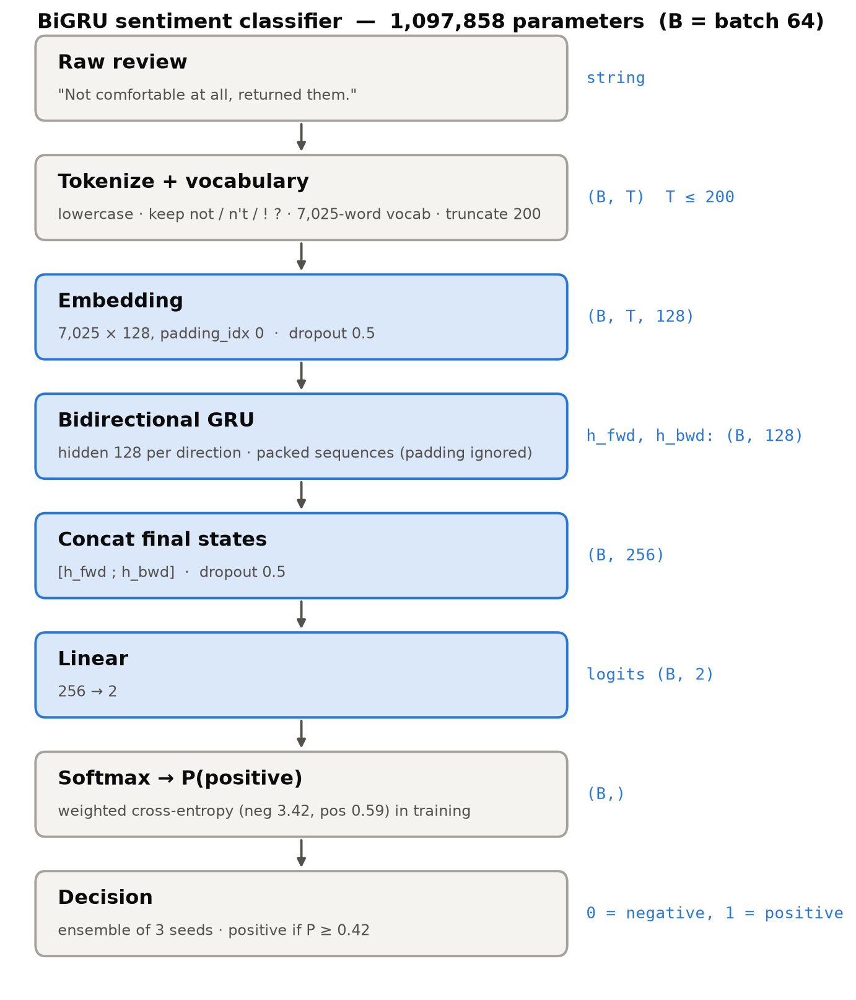
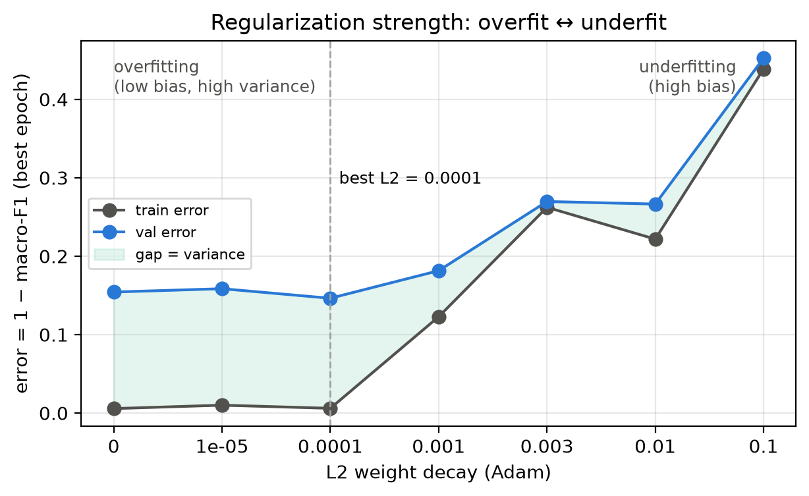

# IE4483 Mini Project (Option 1): Sentiment of Product Reviews

Binary sentiment classification of Amazon clothing/shoe reviews (0 = negative, 1 = positive).
**Due Fri 13 Nov 2026, 11:59pm on NTULearn:** report + `submission.csv`. Brief: [docs/IE4483-Project1.pdf](docs/IE4483-Project1.pdf).

| Member | Part | Report sections | Status |
|---|---|---|---|
| Vũ Ngọc Linh | 1: data, shared split, TF-IDF + LogReg baseline | (a), (f), (g) | done |
| Tai Huynh | 2: Embedding → BiGRU → Linear, tuning | (b), (c) | done |
| Richard Yeo | 3: evaluation, `submission.csv`, error analysis | (d), (e), (h) | done |

## Results (validation, official split: 1,480 reviews, 216 negative)

| Model | Macro-F1 | Accuracy | Negative recall | Report |
|---|---|---|---|---|
| Always "positive" | 0.461 | 0.854 | 0.000 | |
| TF-IDF + Logistic Regression | 0.849 | 0.922 | 0.773 | [baseline_report.md](results/baseline/baseline_report.md) |
| BiGRU, single model (3-seed mean ± std) | 0.858 ± 0.014 | 0.929 | 0.767 | [gru_report.md](results/gru_classifier/gru_report.md) |
| BiGRU, 3-seed ensemble | 0.866 | 0.933 | 0.773 | |
| **BiGRU, ensemble + threshold 0.42** | **0.874** | **0.940** | 0.745 | |

The threshold was tuned on validation, so 0.874 is optimistic; 0.866 is the untuned score.
Test predictions from the final GRU: [results/gru_classifier/test_predictions.csv](results/gru_classifier/test_predictions.csv). It has 1,851 rows in `test.json` order and columns `reviews, predictions, prob_positive`.

## Setup

```bash
python3 -m venv .venv
source .venv/bin/activate
python -m pip install -r requirements.txt     # numpy, pandas, scikit-learn, joblib, matplotlib, reportlab, torch, ipykernel
```

- Everything runs on CPU; no CUDA is needed.
- In VS Code, select `.venv/bin/python` as the interpreter or notebook kernel.

## Repository layout

```
data/                    train.json (7,401) · test.json (1,851) · official split (see below)
analysis/                data reports, split_data.py (creates the shared split)
reports/                 dataset / split / baseline-method PDFs
data_analysis/           Part 1 write-ups: data_analysis.md, question_a.md, question_b_c_baseline.md, question_g.md
baseline/                Part 1 code: TF-IDF + LogReg (train.py, tune.py, report_results.py)
common/                  shared loader for the official split + metrics (used by the GRU)
gru_classifier/          Part 2 code + run.ipynb
results/baseline/        Part 1 metrics, tuning grid, figures
results/gru_classifier/  Part 2 metrics, per-run histories, figures, checkpoints, test predictions
```

## Shared split (everyone uses this)

| File | Rows | Negative | Positive |
|---|---|---|---|
| `data/train_splitted.json` | 5,921 | 866 | 5,055 |
| `data/valid_splitted.json` | 1,480 | 216 | 1,264 |

- **How it's made:** 80/20, stratified by label, seed 42. Identical review texts always stay in the same part, so validation never contains a review copied from train.
- **Files:** indices and fingerprints are in `data/split_manifest.json`; regenerate with `python analysis/split_data.py`.
- **Rule:** fit vocabularies, TF-IDF and class weights on the training part only.

---

## Part 1: Data and TF-IDF baseline (Vũ Ngọc Linh)

| Section | Document |
|---|---|
| Data analysis (charts, duplicates, vocabulary, clustering) | [data_analysis/data_analysis.md](data_analysis/data_analysis.md) |
| (a) Feature format and preprocessing | [data_analysis/question_a.md](data_analysis/question_a.md) |
| Baseline model, training and tuning | [data_analysis/question_b_c_baseline.md](data_analysis/question_b_c_baseline.md) |
| Baseline results and resources | [results/baseline/baseline_report.md](results/baseline/baseline_report.md) |
| (g) Hotel reviews without labels | [data_analysis/question_g.md](data_analysis/question_g.md) |

**Model:**
- **Features:** word unigram + bigram TF-IDF (`min_df=2`, sublinear TF, no stop-word removal), 38,864 sparse features.
- **Classifier:** Logistic Regression with `C=4` and balanced class weights.
- **Tuning:** a 12-trial grid over n-grams × class weights × C ([tuning_results.csv](results/baseline/tuning/tuning_results.csv)).
  - Balanced class weights are essential: unweighted models catch only 4–50% of negatives.

```bash
python baseline/train.py --dry-run     # verify split files only
python baseline/train.py               # train -> artifacts/tfidf_logreg/
python baseline/report_results.py      # export results/baseline/
```

## Part 2: BiGRU classifier (Tai Huynh)

Full write-up for (b) and (c): **[results/gru_classifier/gru_report.md](results/gru_classifier/gru_report.md)**.

**Model.** 7,025-word vocabulary → embedding 128 → BiGRU (hidden 128 per direction) → concat of final states (256) → linear → 2 classes. 1,097,858 parameters.

**Training:**
- Weighted cross-entropy: negative 3.42, positive 0.59.
- Adam with lr 3e-3, dropout 0.5, L2 1e-4.
- Early stopping on validation macro-F1, at most 15 epochs.

**Final prediction:** average of 3 seeds, threshold 0.42.

**Tuning, in stages:**
1. lr × hidden size.
2. dropout × L2.
3. word dropout.
4. seeds, pooling and epoch count.

Then an ensemble and a threshold sweep, plus overfit/underfit studies:
- **L2 sweep:** shows the U-curve from overfitting to underfitting.
- **Data-size learning curve.**
- **Capacity sweep.**

| | |
|---|---|
|  |  |

```bash
.venv/bin/python -m gru_classifier.run_notebook   # Run All on gru_classifier/run.ipynb (finished runs are reused)
.venv/bin/python -m gru_classifier.summary        # results table
.venv/bin/python -m gru_classifier.run_extra      # L2 sweep + 25-epoch runs
.venv/bin/python -m gru_classifier.measure        # resources for (f) -> results/gru_classifier/resources.json
```

- **Re-running:** every epoch is checkpointed. Interrupt and re-run, and finished runs are skipped while unfinished ones resume.
- **Run time:** a full re-run from scratch takes about 45 min on an Apple M4 Pro CPU (4 runs in parallel).

## TF-IDF vs GRU (input for section f)

| | TF-IDF + LogReg | BiGRU (final) |
|---|---|---|
| Feature format | sparse 38,864-dim TF-IDF (word order only within bigrams) | dense 128-d embeddings for a sequence of up to 200 tokens (full word order) |
| Trainable parameters | 38,865 | 1,097,858 |
| Training time | 0.28 s (one fit) | ≈ 177 s per seed (4 runs in parallel, 2 threads each); 3 seeds |
| Validation inference (1,480 reviews) | 0.044 s | 0.32 s per model (× 3 for the ensemble) |
| Peak process memory | 223 MiB | 384 MiB (PyTorch inference process) |
| Stored model | 1.2 MiB | 4.3 MiB per checkpoint (× 3) |
| Validation macro-F1 | 0.849 | 0.858 (single) / 0.866 (ensemble) |

Measurements: [baseline_same_machine.json](results/baseline_same_machine.json) (mean of 3 runs) and [resources.json](results/gru_classifier/resources.json), both on the same Apple M4 Pro CPU. The GRU runs were trained four at a time, so treat the training-time ratio as an order of magnitude. The original baseline run on another machine is in [baseline_metrics.json](results/baseline/baseline_metrics.json).

**Summary:**
- The GRU gains 0.01–0.02 macro-F1, because it reads word order such as "not … at all" or "great but ripped".
- It costs about 28× more parameters, about 630× more training time per seed and about 7× the inference time per model.

## Part 3: Evaluation and submission (Richard Yeo)

- **Submission:** [data/submission.csv](data/submission.csv). Columns `reviews,predictions`, 1,851 rows in `test.json` order; labels from the final BiGRU ensemble (threshold 0.42).
- **Checks for section (d):** `python -m gru_classifier.test_check` writes the validation confusion matrix, the validation-vs-test probability histogram and the agreement with the baseline ([test_check.json](results/gru_classifier/test_check.json)).
- **Examples for section (e):** `python -m gru_classifier.example_edits` re-runs the model on edited versions of the two reviews discussed in the report ([example_edits.json](results/gru_classifier/example_edits.json)).
- **Ignore `data/sampleSubmission.csv`:** its `id,label` format belongs to the other project option.

## Data source

Blitzer, Dredze & Pereira, *Biographies, Bollywood, Boom-boxes and Blenders: Domain Adaptation for Sentiment Classification*, ACL 2007 ([paper](https://www.cs.jhu.edu/~mdredze/publications/sentiment_acl07.pdf), [dataset](https://www.cs.jhu.edu/~mdredze/datasets/sentiment/)).
Labels come from star ratings: above 3 stars is positive, below 3 is negative, and 3-star reviews were dropped.
