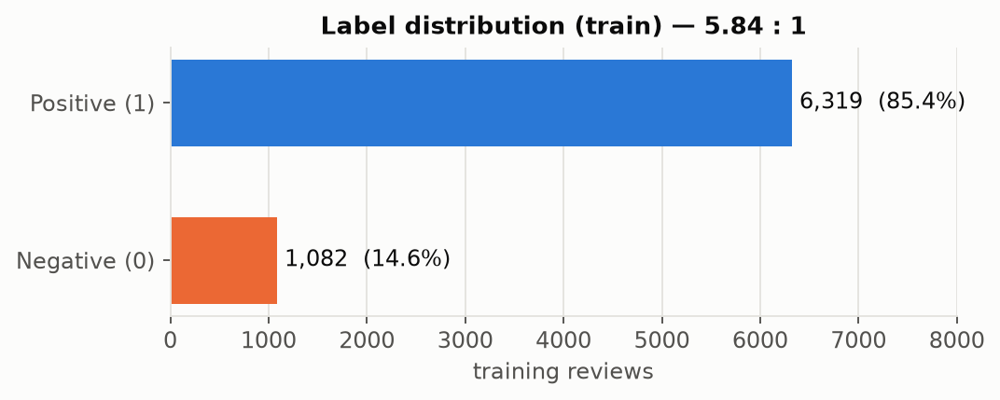
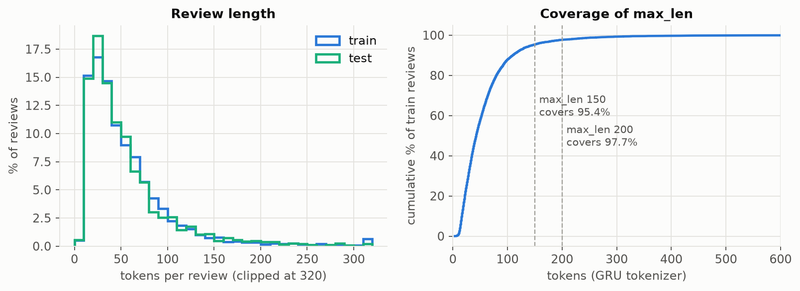
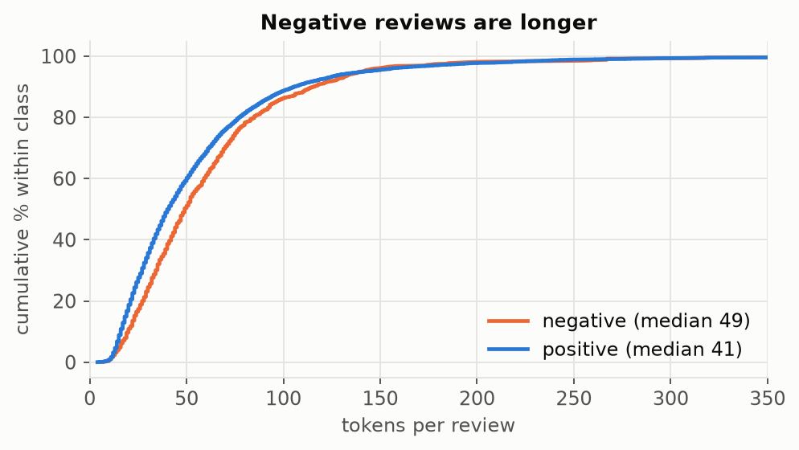
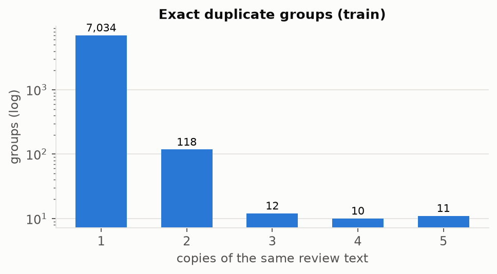
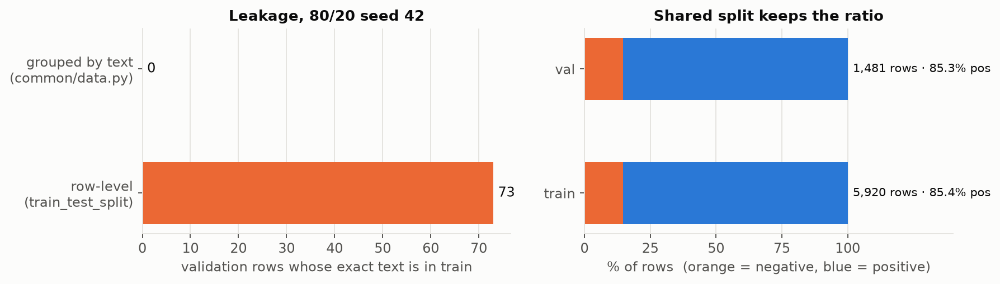
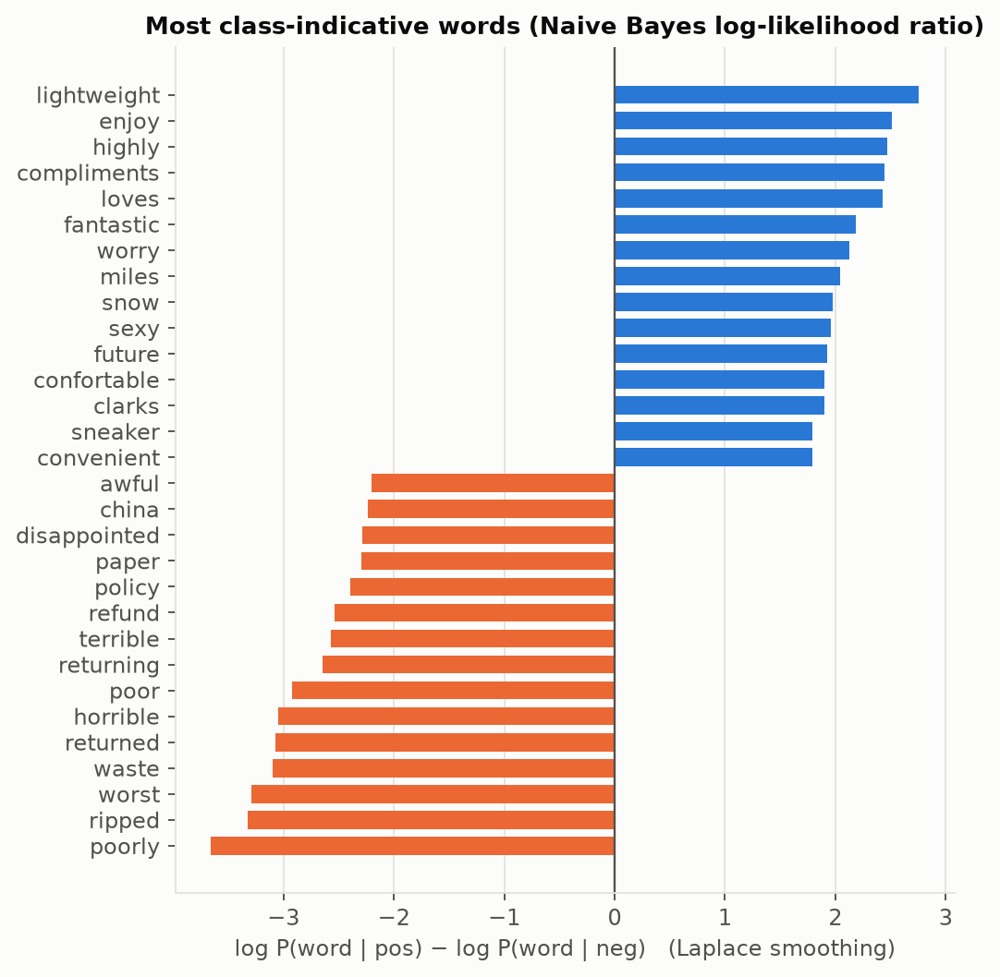
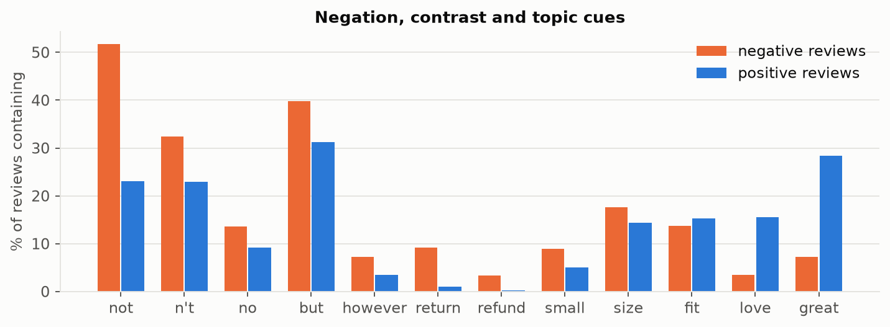
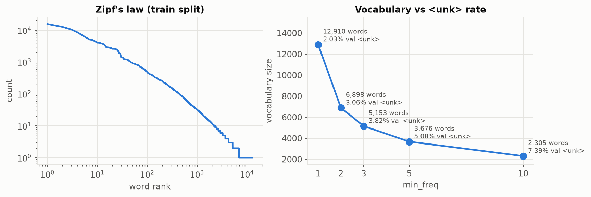
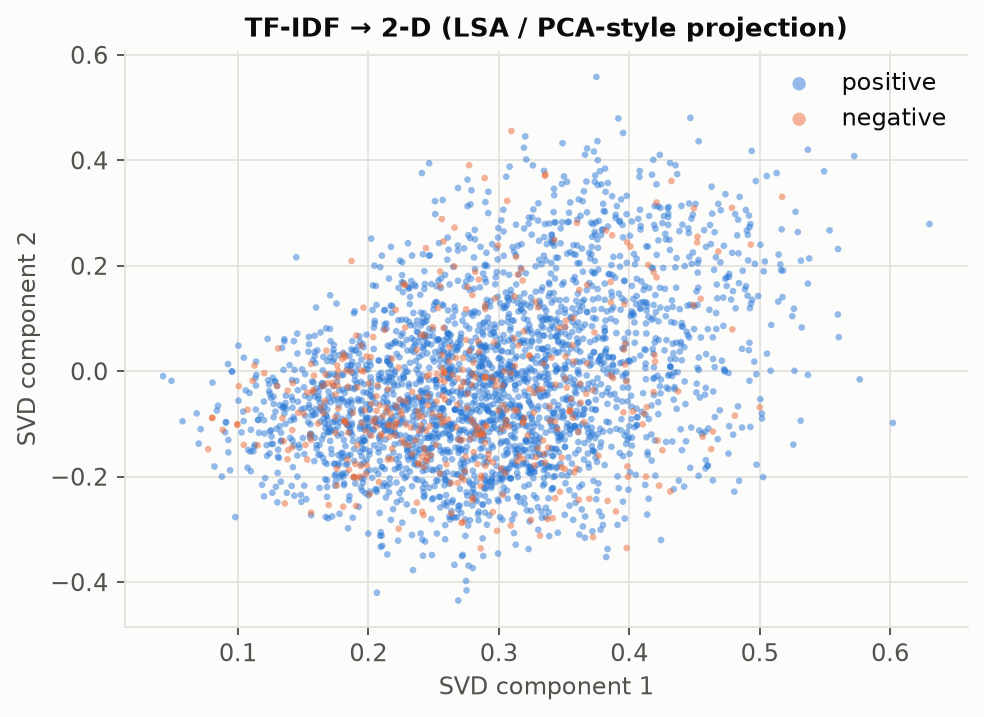
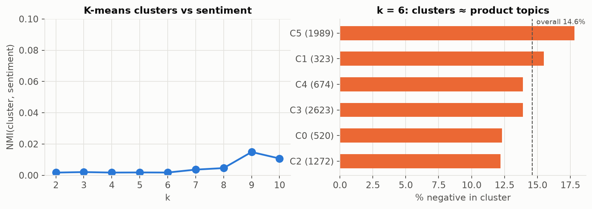

# Data Analysis: Product Review Sentiment (IE4483 Option 1)

**Owner: Vũ Ngọc Linh (Person 1).** Covers report section (a) and supports (f) and (g).
Based on `dataset_analysis.pdf` and `train_split_analysis.pdf`, extended with methods from the course (Bayes, clustering, PCA/SVD, regularization).
Regenerate every chart and number with:

```bash
.venv/bin/python analysis/report_figures.py      # writes figures/ and figures/numbers.json
```

## Key findings

| # | Finding | So we… |
|---|---|---|
| 1 | 85.4% of reviews are positive (5.84 : 1) | report **macro-F1** and negative recall, not just accuracy |
| 2 | 95% of reviews are ≤ 142 words, but the longest has 1,045 | use `max_len` 150–200 (covers 95–98%) |
| 3 | 216 duplicate rows in train, and 101 test rows appear verbatim in train | split **grouped by text**; flag the overlap with test |
| 4 | Negation is the strongest cue: *not* appears in 52% of negative vs 23% of positive reviews | **keep stop-words** such as *not / no / n't* |
| 5 | K-means clusters follow **product type**, not sentiment (NMI ≈ 0.002) | unlabelled clustering alone cannot solve (g) |

---

## 1. Dataset

| | Train | Test |
|---|---|---|
| File | `data/train.json` | `data/test.json` |
| Shape | 7,401 × 2 (`reviews`, `sentiments`) | 1,851 × 1 (`reviews`) |
| Missing / empty reviews | 0 / 0 | 0 / 0 |
| Size on disk | 2.54 MiB | 0.58 MiB |

Labels: 0 = negative, 1 = positive. The test set has no labels. The data has no star rating, product ID, reviewer ID or timestamp, so leakage by product or reviewer cannot be checked.



Predicting "positive" for every review already scores **85.4% accuracy** but finds 0 negatives. Accuracy alone is therefore misleading.

## 2. Review length

Tokens = lowercase text matched by `[a-z']+`.

| Tokens | Min | Mean | Median | P90 | P95 | P99 | Max |
|---|---|---|---|---|---|---|---|
| Train | 4 | 56.5 | 42 | 108 | 142 | 267 | 1,045 |
| Test | 5 | 55.3 | 41 | 110 | 148 | 237.5 | 753 |



Train and test have the same length distribution, so there is no length shift. With the GRU tokenizer, `max_len` = 100 / 150 / 200 / 300 covers **87.9 / 95.4 / 97.7 / 99.3%** of reviews.

| By class | Negative | Positive |
|---|---|---|
| Rows | 1,082 | 6,319 |
| Mean / median length | 62.0 / 49 | 55.5 / 41 |
| P90 / P95 | 115.9 / 140.9 | 106.0 / 142.1 |
| Over 150 tokens | 42 (3.9%) | 282 (4.5%) |



Negative reviews are longer at the median. People explain what went wrong.

## 3. Duplicates and the shared split

| Copies of a text | 1 | 2 | 3 | 4 | 5 |
|---|---|---|---|---|---|
| Groups | 7,034 | 118 | 12 | 10 | 11 |

- 7,185 unique texts and 216 extra duplicate rows; 151 texts appear more than once.
- **No duplicate has conflicting labels.**
- Case-folding and collapsing whitespace finds only 3 more duplicates (7,182 groups).
- Test: 21 duplicates within test, and **101 test rows (87 texts) also appear in train**.



A normal stratified split puts copies of the same review on both sides, so validation rewards memorisation.
The shared split (`common/data.py` → `data/split.json`) is therefore **stratified + grouped by exact text, 80/20, seed 42**.



| | Row-level split (`train_test_split`) | **Shared grouped split** |
|---|---|---|
| Train / val rows | 5,920 / 1,481 | **5,920 / 1,481** |
| Val negative / positive | 217 / 1,264 | **217 / 1,264** |
| Val rows whose text is in train | 73 | **0** |

Rules for everyone:
- Use `get_split()` only. Never re-split.
- Fit the vocabulary, TF-IDF and class weights on the **train side only**.
- Keep test out of every decision.
- Val has only 217 negatives, so **1 missed negative = 0.46 pp of negative recall**. Small differences between models are noise; compare over several seeds.

## 4. What the words say (Naive Bayes view)

Bayes' rule with the naive independence assumption scores each word by its log-likelihood ratio: `log P(w|pos) − log P(w|neg)`, with Laplace (+1) smoothing and words seen ≥ 20 times.



- **Negative** reviews complain about returns (*returned, refund, policy*), damage (*ripped, broke, poorly*) and material (*polyester, wool, smell, paper*).
- **Positive** reviews talk about comfort and compliments (*lightweight, compliments, roomy*) and brands (*clarks, nike*).
- **The words are domain-specific.** They describe clothing and shoes, so they won't transfer to hotel reviews in (g).
- **Typos exist.** *confortable* is a strong positive word, so subword or character features would help.



*not*, *n't*, *but* and *however* are all more common in negative reviews, which are often mixed ("looks great **but** ripped"). Bag-of-words loses this word order, while a sequence model (the GRU) can use it.

## 5. Vocabulary



Word frequency follows **Zipf's law**: 6,012 words appear only once.

| `min_freq` | 1 | **2** | 3 | 5 | 10 |
|---|---|---|---|---|---|
| Vocabulary size (train split) | 12,910 | **6,898** | 5,153 | 3,676 | 2,305 |
| Val tokens → `<unk>` | 2.0% | **3.1%** | 3.8% | 5.1% | 7.4% |

`min_freq = 2` halves the vocabulary (fewer embedding parameters, less overfitting) at the cost of only about 1 pp more unknown words.

## 6. Unsupervised view (clustering + dimensionality reduction)

TF-IDF (stop-words removed) is projected with truncated SVD, which is PCA for sparse text (also called LSA). The first 100 components keep 23.5% of the variance.



The two classes overlap completely in the top 2 components, so **sentiment is not the main source of variance**. K-means on the 100-dimensional representation tells the same story:



| k = 6 cluster | Size | % negative | Top terms |
|---|---|---|---|
| C2 | 1,272 | 12.2 | shoes, shoe, comfortable, pair, feet, wear |
| C0 | 520 | 12.3 | shirt, warm, great, cold, like, good |
| C3 | 2,623 | 13.9 | comfortable, wear, like, just, fit, size |
| C4 | 674 | 13.9 | bag, case, use, wallet, carry, pocket, ipod |
| C1 | 323 | 15.5 | bra, bras, support, comfortable, sports |
| C5 | 1,989 | 17.8 | quality, product, great, price, item, ordered |

The clusters are **product topics** (shoes, bras, bags, shirts). Every cluster has roughly the base rate of 12–18% negative, and NMI with the sentiment label is ≤ 0.015 for k = 2–10.
**For (g) (hotel reviews, no labels):** clustering will group reviews by aspect (room, location, staff), not by polarity. Options:
- **Adapt a labelled model** with domain adaptation (pivot words such as *excellent* / *awful*, as in Blitzer et al. 2007).
- **Pseudo-labelling** of confident predictions.
- **A pretrained language model** such as BERT.

## 7. Implications for the report

| Section | Use |
|---|---|
| (a) preprocessing | lowercase; keep negations and `!`/`?`; no HTML cleaning needed; vocabulary from train only, `min_freq=2`; `max_len` 150–200 |
| (c) tuning | select on **val macro-F1**; 217 val negatives → average over seeds; regularize (vocabulary pruning, dropout, L2, early stopping) |
| (e) examples | avoid the 101 test reviews that are copies of train reviews; use negation ("not bad") and contrast ("great but ripped") cases |
| (f) features | TF-IDF ≈ 38k sparse dims (uni+bigram) vs GRU 6.9k-word vocabulary with dense embeddings |
| (g) no labels | clusters = topics, not sentiment (Section 6) → domain adaptation / pseudo-labels |
| (h) noisy labels | labels come from star ratings (Blitzer et al. 2007), so some noise already exists; Section 3's duplicates have consistent labels |

Data source: Blitzer, Dredze & Pereira, *Biographies, Bollywood, Boom-boxes and Blenders*, ACL 2007 ([dataset](https://www.cs.jhu.edu/~mdredze/datasets/sentiment/)).
