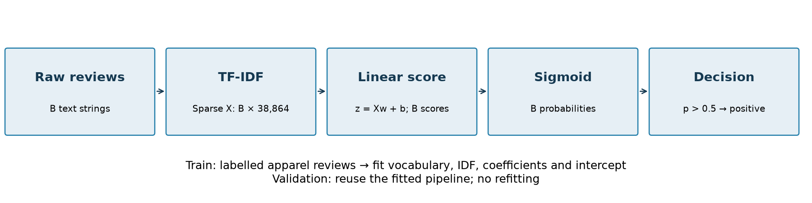

# TF-IDF + Logistic Regression: report for questions (b) and (c)

Baseline contribution | 8 November 2026

## (b) Model, training strategy and reproducibility

### Architecture

We use a supervised binary Logistic Regression classifier over sparse word-level TF-IDF features. This provides a linear baseline for comparison with the group's neural classifier. The targets are 0 = negative and 1 = positive. Feature extraction and classification form one scikit-learn Pipeline; they are saved together to ensure consistent inference.



Figure 1. B denotes the number of reviews processed together. TF-IDF is the feature representation; Logistic Regression is the trainable sentiment classifier. The pipeline contains no recurrent layers or hidden neural layers.

| Stage | Shape for B reviews | Details |
|---|---|---|
| Raw input | B text strings | One apparel review per record |
| TF-IDF features | (B, 38,864) | Float64 sparse unigram and bigram vectors |
| Learned coefficients | (1, 38,864) | One binary-class coefficient vector |
| Learned intercept | (1,) | A single bias term |
| Linear score / positive probability | (B,) / (B,) | One logit and positive probability per review |
| predict_proba API | (B, 2) | Columns correspond to classes [0, 1] |
| Final labels | (B,) | Integer labels 0 or 1 |

The model has 38,865 learned classifier parameters: 38,864 coefficients and one intercept. The training feature matrix has shape (5,921, 38,864); validation has shape (1,480, 38,864). Vocabulary and IDF are additional training-derived state, not classifier coefficients. TF-IDF needs no sequence padding or truncation. Its sparse vectors are L2-normalized, which is distinct from the classifier's L2 regularization.

For review vector x, the binary decision is:

```text
z = w dot x + b
p(positive | x) = 1 / (1 + exp(-z))
predicted label = 1 if p > 0.5, otherwise 0
```

<!-- pagebreak -->

### Loss function and training strategy

The classifier minimizes class-weighted binary cross-entropy with an L2 penalty. An equivalent summed objective for the configured solver is shown below; multiplying the whole objective by a positive constant does not change its minimizer. The intercept is not included in the L2 penalty. [1]

```text
loss_i = -y_i ln(p_i) - (1 - y_i) ln(1 - p_i)
J(w, b) = sum_i a_i * loss_i + ||w||_2^2 / (2C)
a_i = N_train / (2 * count_of_class(y_i))
```

Balanced class weights are computed from training labels only: negative = 3.4186 and positive = 0.5857. This increases the relative contribution of minority-class errors without resampling reviews. C controls inverse regularization strength. Weighted probabilities are not assumed to be calibrated to the original class prevalence. [2]

| Training choice | Implementation |
|---|---|
| Shared split | 5,921 train / 1,480 validation; approximately 80/20; seed 42 |
| Duplicate handling | All copies of an exact review string remain in the same partition |
| Leakage prevention | Verify manifest fingerprints, indices, coverage and zero exact-text overlap; fit vocabulary and IDF only on training |
| Optimizer | L-BFGS (lbfgs); full training set, no mini-batch sampling |
| Stopping | tol = 0.0001; max_iter = 2,000; convergence warnings treated as errors |
| Observed convergence | 16 iterations for the selected configuration, not 2,000 epochs |
| Evaluation | Transform validation using fitted TF-IDF; calculate accuracy, macro-F1, per-class metrics and confusion matrix |

### Reproducibility

We retain the shared split manifest and file SHA-256 fingerprints, record configuration and library versions, and set random_state=42. L-BFGS does not use this random_state parameter: with fixed inputs and settings, there is no random neural initialization, dropout or stochastic batch ordering. The tuning grid limits numerical libraries to one thread. The same selected configuration reproduces the existing baseline's scores and confusion matrix. This is not a multi-seed average or cross-validation result; small numerical differences across environments may still occur. [2]

Recorded versions are Python 3.14.9, scikit-learn 1.9.1, NumPy 2.5.4 and joblib 1.6.0. Fixing a split supports reproducibility, but does not quantify uncertainty across alternative train/validation samples. No official test reviews or test labels are used for model selection.

<!-- pagebreak -->

## (c) Hyperparameter consideration and determination

### Experimental design and rationale

The initial baseline used C=4, unigrams+bigrams and balanced class weights as starting choices. We subsequently evaluated a controlled 12-configuration grid on the same shared split to examine these choices. Each trial is trained from scratch using training data only. The grid varies three settings while keeping tokenization, min_df, normalization, solver and stopping settings fixed.

| Setting | Values considered / retained | Reason |
|---|---|---|
| Word n-grams | Unigrams; unigrams + bigrams | Test whether short phrases such as not good improve classification |
| Class weighting | None; balanced | Test the effect of weighting the minority negative class |
| C | 0.5, 1, 4 | Compare stronger and weaker L2 regularization |
| min_df | Fixed at 2 | Remove singleton features; not tuned in this study |
| TF-IDF weighting | Sublinear TF, smoothed IDF, L2 normalization | Temper repetition and normalize vector magnitude; held fixed |
| Tokenization | Lowercase, retain contractions; no stop-word removal | Preserve negation; held fixed |
| Solver / tolerance | lbfgs / 0.0001 | Convex linear-model optimization; no manual learning-rate grid |
| Decision threshold | Fixed at 0.5 | Keep the decision rule consistent across trials; not tuned |

The primary selection metric is validation macro-F1, giving equal importance to the two class F1 scores. Accuracy alone is insufficient: the always-positive reference achieves 85.41% accuracy but zero negative recall. Negative recall and precision are inspected to understand the trade-off, rather than selecting a model solely for high negative recall. Exact macro-F1 ties would retain the first enumerated configuration; no winning tie occurred.

Unlike a GRU trained with Adam or SGD, this L-BFGS implementation has no user-selected learning rate, batch size, hidden size or dropout rate. Its numerical step sizes are handled internally by the optimizer. These neural-model settings are therefore not applicable to this classifier.

<!-- pagebreak -->

### Validation grid results

| Features | Class weight | C | Accuracy | Macro-F1 | Negative recall |
|---|---|---|---|---|---|
| Uni | none | 0.5 | 87.03% | 0.5647 | 11.11% |
| Uni | none | 1 | 88.85% | 0.6797 | 27.78% |
| Uni | none | 4 | 91.01% | 0.7829 | 49.54% |
| Uni | balanced | 0.5 | 88.72% | 0.8055 | 81.94% |
| Uni | balanced | 1 | 90.27% | 0.8267 | 82.41% |
| Uni | balanced | 4 | 91.01% | 0.8332 | 79.17% |
| Uni + bi | none | 0.5 | 85.95% | 0.4977 | 3.70% |
| Uni + bi | none | 1 | 87.43% | 0.5907 | 14.35% |
| Uni + bi | none | 4 | 90.81% | 0.7643 | 43.52% |
| Uni + bi | balanced | 0.5 | 90.34% | 0.8243 | 79.63% |
| Uni + bi | balanced | 1 | 90.88% | 0.8324 | 80.09% |
| Uni + bi | balanced | 4 | 92.23% | 0.8490 | 77.31% |

The highest macro-F1 among the tested configurations is **0.8490**, obtained with **unigrams + bigrams, balanced class weights and C=4**. This agrees with the original baseline configuration, which remains unchanged.

At C=4 with bigrams, balancing improves macro-F1 from 0.7643 to 0.8490 and negative recall from 43.52% to 77.31%. With balancing and C=4 held fixed, adding bigrams improves macro-F1 from 0.8332 to 0.8490. Within the balanced bigram trials, increasing C from 0.5 to 4 improves macro-F1 from 0.8243 to 0.8490, although negative recall falls from 79.63% to 77.31%. The selected configuration offers a better overall class-wise F1 balance, not the highest negative recall in the grid.

### Selected-model outcome and limitations

The selected baseline achieves **92.23% accuracy**, **0.8490 macro-F1**, negative precision **0.7167**, negative recall **0.7731** and negative F1 **0.7439**. Its confusion matrix, with true labels as rows and predictions as columns, is [[167, 49], [66, 1198]], ordered [negative, positive].

These results support the choice only within this small grid. C=4 lies at the search boundary; larger values could be investigated, but no global optimum is claimed. min_df and the threshold were not tuned. Reusing a single validation set for selection introduces selection optimism; it is not an independent final test estimate. The 216 validation negatives also limit the precision of minority-class estimates. No confidence intervals or cross-validation averages were calculated.

Numerical libraries used one thread during tuning. The original baseline's thread allocation was not recorded, so the tuning fit times must not be compared directly with its 5.39-second runtime. The existing resource report remains the record of the original run.

<!-- pagebreak -->

## Code, execution and evidence

Run from the repository root on Linux/macOS:

```bash
python3 -m venv .venv
source .venv/bin/activate
python -m pip install -r requirements.txt
python baseline/train.py --dry-run
# A new result directory avoids overwriting the original run:
python baseline/train.py --C 4 --ngram-max 2 --class-weight balanced \
  --output-dir artifacts/tfidf_logreg_reproduction
python -m unittest discover -s baseline/tests -v
```

Training saves a fitted model.joblib pipeline, metrics.json and validation_predictions.csv in the chosen artifact directory. The CSV preserves original validation source indices for error analysis. These are validation predictions, not the assignment's final test submission. No full-data refit or test export is performed by this training entry point.

To reproduce the tuning grid without overwriting recorded evidence:

```bash
python baseline/tune.py \
  --output-dir results/baseline/tuning_reproduction \
  --artifact-dir artifacts/tfidf_logreg_tuning_reproduction
```

Each grid run records settings, scores, feature counts, convergence iterations and fit times. The winning pipeline from the recorded grid is saved locally as artifacts/tfidf_logreg_tuning/best_model.joblib. Model binaries are ignored by Git; the grid evidence is retained as JSON and CSV. A fresh directory is required for each reproduction run.

| Evidence | Repository location |
|---|---|
| Pipeline, training and evaluation | baseline/train.py |
| 12-trial grid and selection rule | baseline/tune.py |
| Focused toy-data checks | baseline/tests/test_baseline.py |
| Recorded grid | results/baseline/tuning/tuning_results.json and tuning_results.csv |
| Original baseline scores and resources | results/baseline/baseline_metrics.json |
| Shared split and source fingerprints | data/split_manifest.json |
| Architecture figure | results/baseline/baseline_architecture.png |

The architecture, dimensions and selected scores above are checked against the saved baseline and tuning evidence. The unit tests additionally check vocabulary isolation from validation, saved-model prediction consistency and negative-class metric handling.

### References

[1] scikit-learn, Linear Models: Logistic Regression. https://scikit-learn.org/stable/modules/linear_model.html#logistic-regression

[2] scikit-learn, LogisticRegression API. https://scikit-learn.org/stable/modules/generated/sklearn.linear_model.LogisticRegression.html
