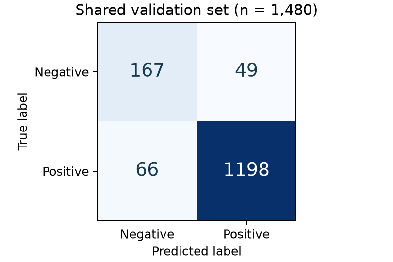

# TF-IDF + Logistic Regression: validation results

Evaluation uses the shared training partition (5,921 reviews) and validation partition (1,480 reviews: 216 negative, 1,264 positive), with seed 42 and no exact-text overlap. This report verifies and summarizes the existing artifacts/tfidf_logreg run; it does not retrain the model or use the official test set.

## Configuration

Word unigram + bigram TF-IDF; min_df=2; sublinear TF; smoothed IDF; L2-normalized float64 vectors; lowercase, contraction-preserving tokenizer, no stop-word removal. Logistic Regression: C=4, balanced class weights, lbfgs, max_iter=2000, random_state=42. Vocabulary and IDF are fitted on training only; decision threshold is 0.5 (positive when probability > 0.5).

## Predictive performance

| Model | Accuracy | Macro-F1 | Negative recall |
| --- | --- | --- | --- |
| TF-IDF + Logistic Regression | 92.23% | 0.8490 | 77.31% |
| Always positive | 85.41% | 0.4606 | 0.00% |

| Class | Precision | Recall | F1 | Support |
| --- | --- | --- | --- | --- |
| negative | 0.7167 | 0.7731 | 0.7439 | 216 |
| positive | 0.9607 | 0.9478 | 0.9542 | 1264 |

### Confusion matrix

Rows are true labels; columns are predicted labels.

| True / predicted | Negative (0) | Positive (1) |
| --- | --- | --- |
| Negative (0) | 167 | 49 |
| Positive (1) | 66 | 1198 |



The baseline correctly classifies 1,365 of 1,480 validation reviews. Accuracy exceeds the always-positive reference by 6.82 percentage points. It detects 167 of 216 negative reviews, missing 49, and incorrectly labels 66 positive reviews as negative. Minority-class F1 is lower than positive-class F1. These are single-split results for the initial configuration, not a completed tuning study or a final test score.

## Resource consumption

| Measurement | Value |
| --- | --- |
| Fit wall time (TF-IDF + classifier) | 5.3917 s |
| Validation predict_proba wall time (including transform) | 0.1575 s / 1,480 reviews |
| Average batch inference time per review | 0.1064 ms |
| Process lifetime peak RSS | 188.58 MiB |
| Training feature shape | [5921, 38864] |
| Validation feature shape | [1480, 38864] |
| Training nonzeros / density | 487,630 / 0.2119% |
| Training CSR numeric arrays | 5.603 MiB |
| Validation CSR numeric arrays | 1.274 MiB |
| Hypothetical dense training float64 array | 1,755.63 MiB (calculated, not allocated) |
| Serialized vectorizer + classifier | 1.156 MiB |
| Solver iterations | 16 |

Fit time includes training vectorization and classifier fitting, but excludes data loading, validation, serialization and reporting. Validation time includes vectorization and probability prediction for one batch; per-review time is batch time divided by 1,480, not standalone request latency. Peak RSS is the process lifetime peak captured after feature diagnostics, including imports and Python overhead; it is not incremental model RAM or a separately isolated fit peak, and excludes later serialization. CSR sizes count data/indices/indptr arrays only, excluding vocabulary and object overhead. Serialized file size is disk storage. The hypothetical dense-array size is a calculation, not measured RAM usage.

## Future comparison for question (f)

Runtime and memory are observations from one saved run, not repeated benchmark averages. The original metrics do not record CPU model, allocated threads, BLAS configuration or host load; these cannot be reconstructed reliably after the run. For the future GRU comparison, record hardware, thread/device settings, timing boundaries, peak-memory method, versions and the same split. Compare both feature storage and end-to-end pipeline resources. Since representation and classifier both differ, do not attribute all accuracy differences to feature format alone. GRU results remain pending.

## Reproducibility

Versions: python 3.14.9, sklearn 1.9.1, numpy 2.5.4, joblib 1.6.0.

Original measurements: [baseline_metrics.json](baseline_metrics.json). Verification: [baseline_verification.json](baseline_verification.json). Model and row-level predictions remain in artifacts/tfidf_logreg/ (ignored by Git).

```bash
# Re-export and verify this existing run without refitting
.venv/bin/python baseline/report_results.py

# To measure a new run, choose a fresh artifact directory
.venv/bin/python baseline/train.py --output-dir artifacts/tfidf_logreg_new
.venv/bin/python baseline/report_results.py --run-dir artifacts/tfidf_logreg_new --output-dir results/baseline/new_run
```
