# BiGRU Classifier: Report Sections (b) and (c)

**Owner: Tai Huynh (Person 2).** Uses the official split `data/split_manifest.json`: 5,921 train / 1,480 validation, with 216 negatives in validation.
All numbers are **validation** scores. The test set has no labels.

| Model (validation) | Macro-F1 | Accuracy | Negative recall |
|---|---|---|---|
| Always "positive" | 0.461 | 0.854 | 0.000 |
| TF-IDF + LogReg ([baseline](../baseline/baseline_report.md)) | 0.849 | 0.922 | 0.773 |
| BiGRU, single model (mean ± std of 3 seeds) | 0.858 ± 0.014 | 0.929 | 0.767 |
| BiGRU, ensemble of 3 seeds | 0.866 | 0.933 | 0.773 |
| **BiGRU, ensemble + threshold 0.42 (final)** | **0.874** | **0.940** | 0.745 |

The threshold 0.42 was tuned on the same validation set, so 0.874 is slightly optimistic; 0.866 is the untuned figure.

---

## (b) Model

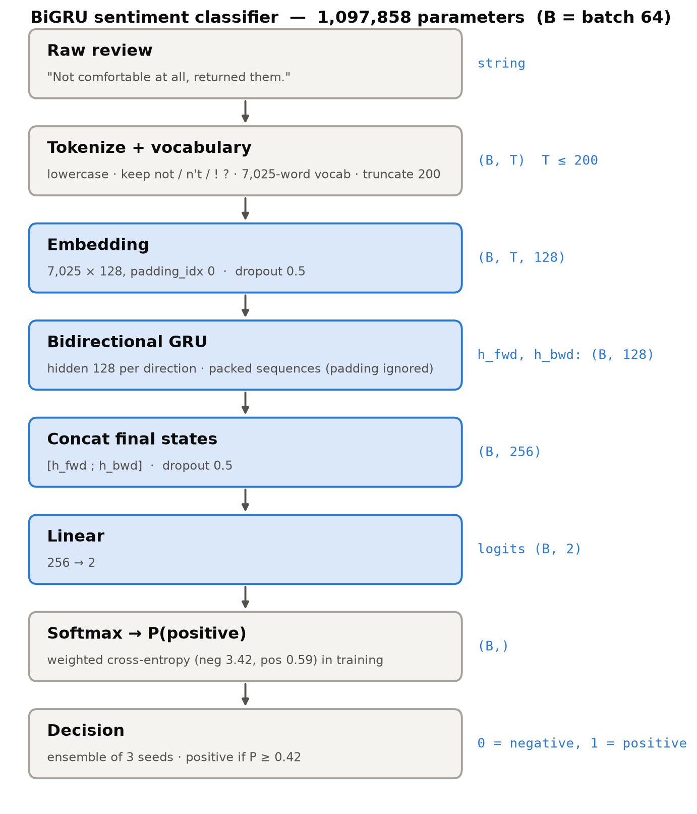

| Layer | Output shape | Parameters |
|---|---|---|
| Input: token ids (vocabulary 7,025, `<pad>`=0, `<unk>`=1) | (B, T), T ≤ 200 | – |
| Embedding 128 + dropout 0.5 | (B, T, 128) | 899,200 |
| BiGRU, hidden 128 per direction (packed, padding ignored) | 2 × (B, 128) | 198,144 |
| Concat final forward/backward states + dropout 0.5 | (B, 256) | – |
| Linear 256 → 2 | (B, 2) logits | 514 |
| **Total** | | **1,097,858** |

**Preprocessing:**
- Lowercase, tokenize with `[a-z0-9]+('[a-z]+)?|[!?]`.
- Keep negations (*not, don't*) and `!`/`?`; no stop-word removal.
- Vocabulary from the training split only, `min_freq = 2`.
- Truncate to 200 tokens, which covers 97.7% of reviews.

**Loss:** class-weighted cross-entropy, w_c = N / (2·n_c), giving **negative 3.42 / positive 0.59**. This counters the 85/15 imbalance.

**Training:**
- Adam, learning rate 3e-3, L2 weight decay 1e-4, batch 64, gradient clipping 1.0.
- At most 15 epochs. Early stopping (patience 3) on validation macro-F1, keeping the best epoch.

**Inference:** average P(positive) over 3 seeds (42, 7, 123); predict positive if P ≥ 0.42.

**Reproducibility:**
- Fixed seeds, and the shuffle order is seeded per epoch.
- Every epoch is checkpointed, so an interrupted run resumes where it stopped.
- Results are reported as mean ± std over 3 seeds. Two separate runs of one configuration with the same seed give identical validation macro-F1 at every epoch; different seeds differ more (std 0.014), which is why single-run differences below 0.01 are treated as ties.

**Cost (M4 Pro CPU, 4 runs in parallel):** 11–14 s/epoch and 2.5–3.5 min per run. The whole study (43 runs) took 113 CPU-minutes, about 45 min wall time.

**How to run:**

```bash
pip install -r requirements.txt
.venv/bin/python -m gru_classifier.run_notebook   # = Run All on gru_classifier/run.ipynb; finished runs are reused
.venv/bin/python -m gru_classifier.summary        # results table
```

Outputs:
- `results/gru_classifier/test_predictions.csv`: columns `reviews, predictions, prob_positive`, in `test.json` order. Prediction counts: 229 negative / 1,622 positive.
- `results.csv`: one row per run.
- `runs/<run>/history.csv`: per-epoch metrics.
- `figures/`: all charts.

| File | Role |
|---|---|
| `gru_classifier/text.py` | tokenizer and vocabulary |
| `gru_classifier/model.py` | `GRUClassifier` |
| `gru_classifier/train.py` | training, checkpoint/resume, parallel grid search, prediction |
| `gru_classifier/experiments.py` | L2 sweep, capacity sweep, data-size curve, seed runs |
| `gru_classifier/optimize.py` | seed ensemble and threshold tuning |
| `gru_classifier/run.ipynb` | the full pipeline; just Run All |

---

## (c) Choosing the parameters

**Method.** A staged search, changing one group of hyperparameters at a time and keeping the best setting before moving on.
- **Selection metric: validation macro-F1.** Accuracy rewards predicting "positive" (85.4%).
- **Small differences are noise.** Validation has only 216 negatives, so one review changes negative recall by 0.46 pp; differences below about 0.01 are treated as ties.

### Stage 1: learning rate × hidden size (dropout 0.3, no L2)

| lr \ hidden | 64 | 128 | 256 |
|---|---|---|---|
| 1e-3 | 0.822 | 0.821 | 0.830 |
| **3e-3** | 0.815 | **0.831** | 0.816 |
| 1e-2 | 0.815 | 0.805 | 0.772 |

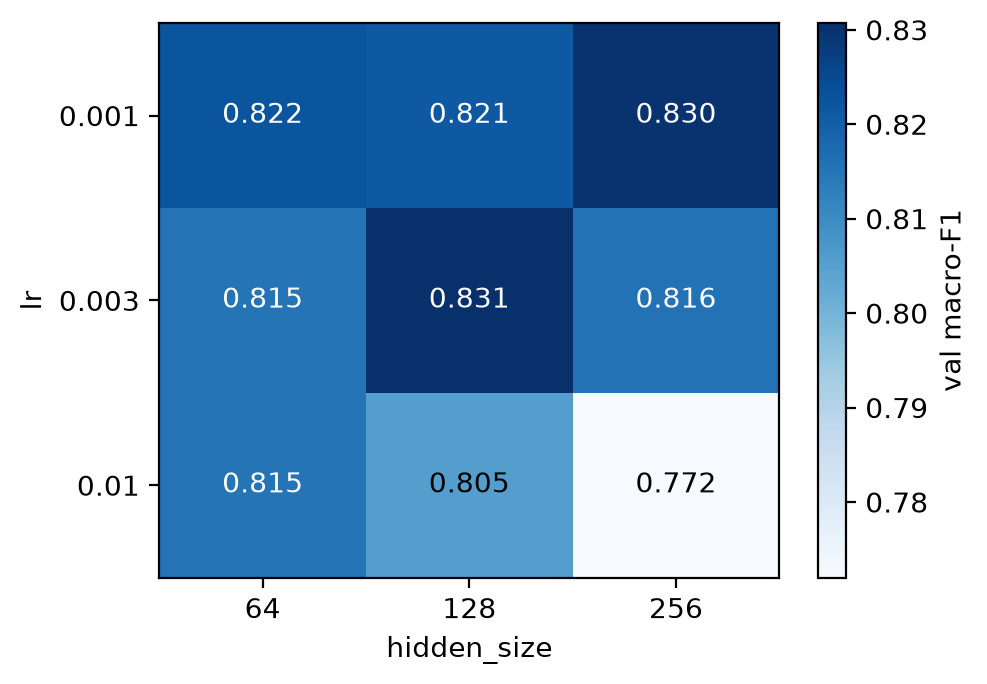
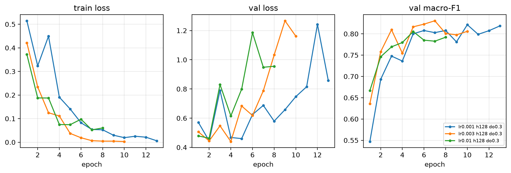

- **lr 1e-2 is too high.** Loss jumps around, it peaks at epoch 2–6 and is worst with hidden 256.
- **lr 1e-3 is slow.** It needs 9–13 epochs.
- **Chosen: lr 3e-3 with hidden 128.** It is as good as the best hidden-256 run (0.830) at about half the training time.

### Stage 2: regularization, dropout × L2

| dropout \ L2 | 0 | 1e-5 | 1e-4 |
|---|---|---|---|
| 0 | 0.800 | 0.825 | 0.819 |
| 0.3 | 0.831 | 0.819 | 0.847 |
| **0.5** | 0.846 | 0.842 | **0.854** |

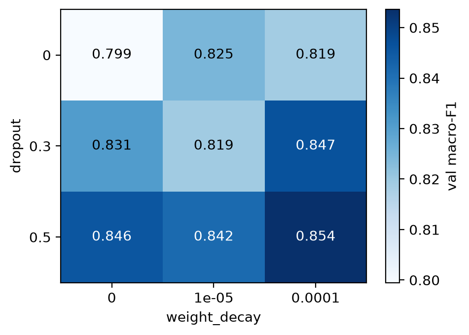
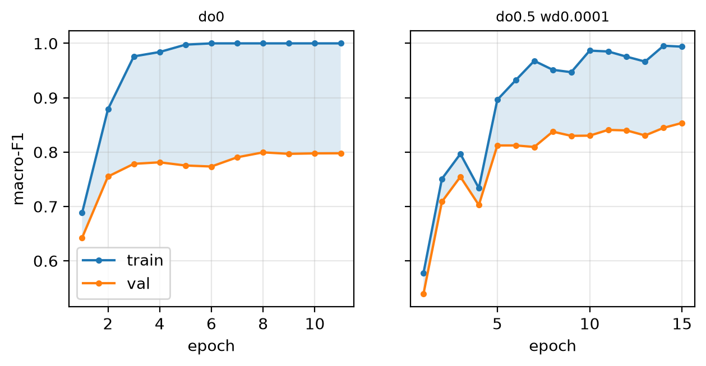

- Without regularization, train macro-F1 reaches 1.000 while validation stays at 0.80: a gap of 0.20, which is **overfitting**.
- **Chosen: dropout 0.5 + L2 1e-4.** Validation macro-F1 is 0.054 higher than with no regularization (+0.023 over stage 1), and the gap shrinks to 0.14.

### Stage 3: word dropout (data augmentation)

| Word dropout | 0 | 0.1 | 0.2 |
|---|---|---|---|
| Val macro-F1 | **0.854** | 0.836 | 0.853 |
| Train − val gap | 0.140 | 0.108 | 0.116 |

Word dropout replaces random tokens with `<unk>`. It narrows the gap but does not improve validation, so it is **not used**.

### Stage 4: seeds, pooling, epochs

| Setting | Val macro-F1 (3 seeds) |
|---|---|
| **Final config, last hidden state** | **0.858 ± 0.014** |
| Mean + max pooling over all time steps | 0.853 ± 0.005 |
| 25 epochs instead of 15 | 0.859 |

Neither alternative clearly beats the final config, so the simpler options are kept: last-state pooling and 15 epochs.

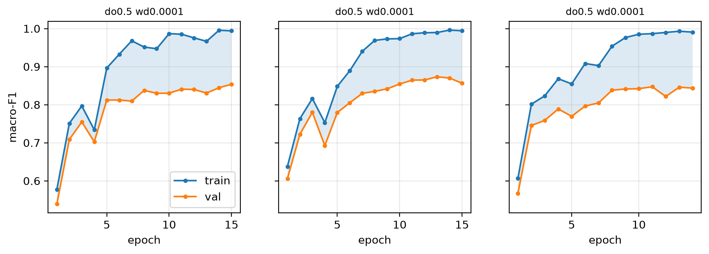

### Ensemble and decision threshold

| | Macro-F1 @0.5 | Best threshold | Macro-F1 @best |
|---|---|---|---|
| Seed 42 | 0.854 | 0.42 | 0.856 |
| Seed 7 | 0.873 | 0.21 | 0.875 |
| Seed 123 | 0.847 | 0.21 | 0.851 |
| **Ensemble** | **0.866** | **0.42** | **0.874** |

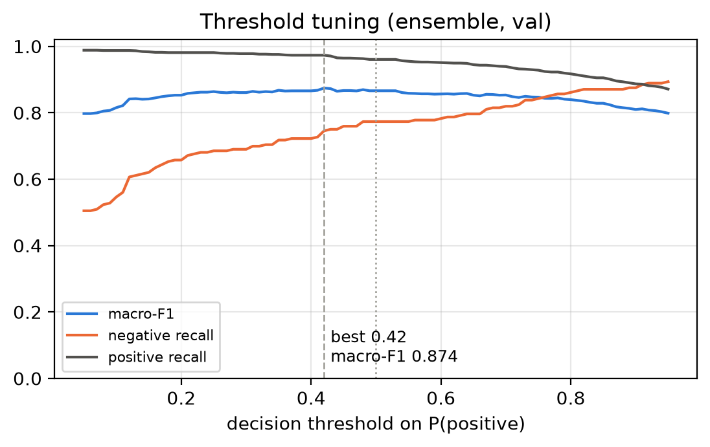

- Averaging 3 seeds lowers variance: the ensemble scores 0.866, above the 0.858 single-model average.
- A threshold of 0.42 trades a little negative recall for higher positive precision.

### Underfitting vs overfitting

**Regularization strength (main chart).** This sweeps L2 on the final config; it is the bias–variance trade-off from the regularization lecture.

| L2 | 0 | 1e-5 | **1e-4** | 1e-3 | 3e-3 | 1e-2 | 0.1 |
|---|---|---|---|---|---|---|---|
| Train macro-F1 | 0.994 | 0.990 | 0.994 | 0.877 | 0.738 | 0.778 | 0.561 |
| Val macro-F1 | 0.846 | 0.842 | **0.854** | 0.819 | 0.730 | 0.734 | 0.548 |
| Diagnosis | overfit | overfit | **best** | | underfit | underfit | underfit |

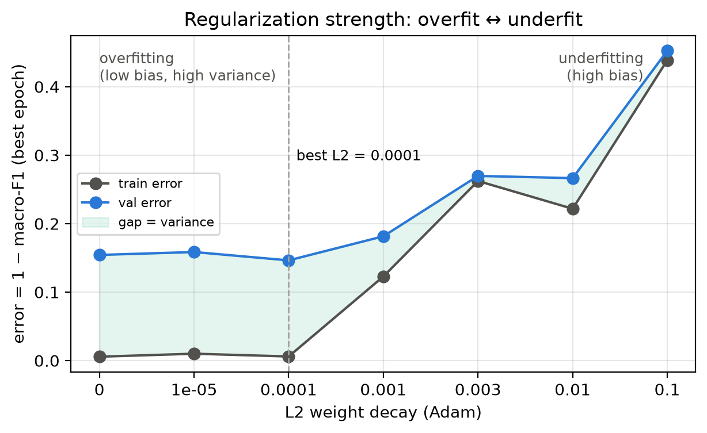

- **Weak L2: overfitting** (low bias, high variance). Train is about 1.0 and validation about 0.85.
- **Strong L2: underfitting** (high bias). Train and validation are both low and close, e.g. 0.56 / 0.55 at L2 = 0.1.

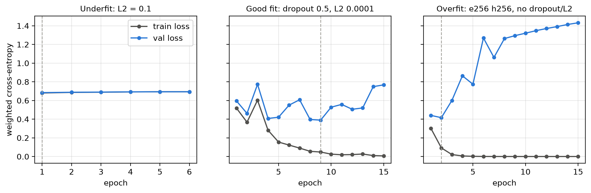

- **Underfit** (L2 = 0.1): the loss never drops.
- **Good fit** (final config, seed 42): validation loss is lowest around epochs 8–9 and then rises, while validation macro-F1 keeps improving (0.830 at epoch 9, 0.854 at epoch 15). Checkpoints are chosen by the highest validation macro-F1, not the lowest loss, so the kept epoch is 15 (13 and 11 for the other two seeds).
- **Overfit** (embed 256, hidden 256, no regularization): train loss goes to 0 while validation loss climbs from epoch 2.

**Data size.** Adding data shrinks the gap. The validation curve has not levelled off, so more labelled reviews would still help.

| Training reviews | 592 | 1,480 | 2,960 | 4,440 | 5,921 |
|---|---|---|---|---|---|
| Train macro-F1 | 0.879 | 0.975 | 0.963 | 0.995 | 0.994 |
| Val macro-F1 | 0.645 | 0.737 | 0.787 | 0.838 | 0.854 |

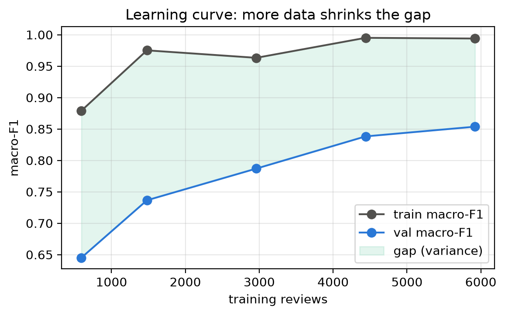

**Capacity.** Without regularization, every size from 28k to 2.6M parameters reaches train macro-F1 ≥ 0.95, and 1.00 from 114k parameters up. With 5.9k reviews, shrinking the model alone does not fix overfitting; dropout, L2 and early stopping do.

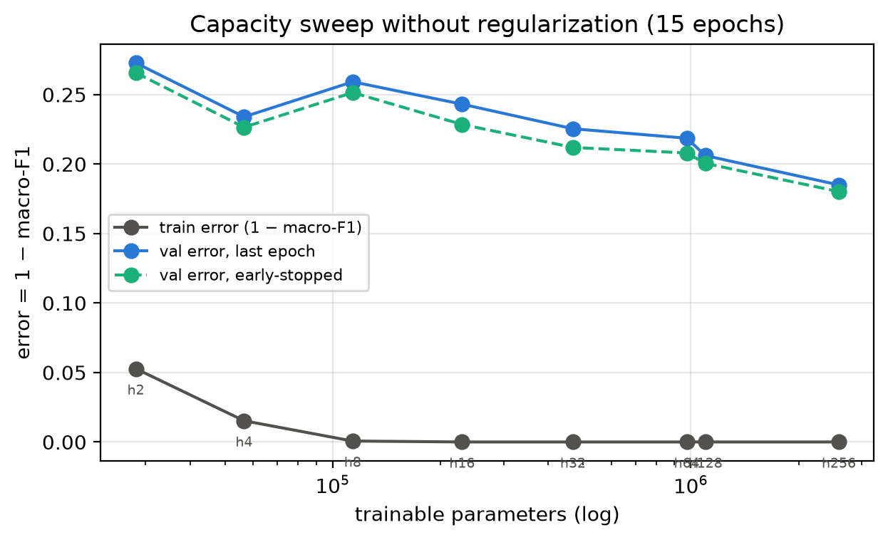

### Final choice

| Parameter | Value | Why |
|---|---|---|
| Learning rate | 3e-3 | 1e-2 unstable, 1e-3 slow |
| Hidden / embedding | 128 / 128 | 256 is no better and twice as slow |
| Dropout | 0.5 | largest gain in stage 2 |
| L2 | 1e-4 | bottom of the U-curve; larger values underfit |
| Word dropout / pooling | none / last state | no validation gain |
| Epochs | ≤ 15, early stopping (patience 3) | 25 epochs added 0.001 |
| Class weights | 3.42 / 0.59 | counters the 85/15 imbalance (not ablated for the GRU) |
| Inference | 3-seed ensemble, threshold 0.42 | +0.008 over a single model; threshold +0.008 |

**Limitations:**
- Validation was used for every selection, including the threshold, so the final 0.874 is optimistic.
- Run-to-run noise (std 0.014) is of the same order as many of the differences above.
